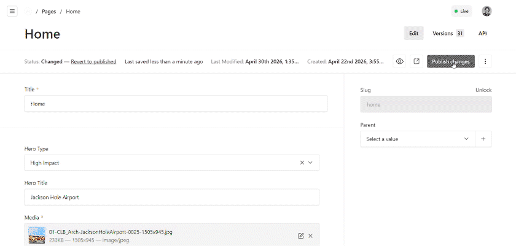

# Payload Cloudflare Build Status

Payload admin plugin that shows the latest Cloudflare Workers Build status as a compact admin badge.

<p align="center">
  
</p>

Built for headless Payload setups, especially Payload plus an Astro SSG frontend deployed through Cloudflare Workers Builds. It is display-only: it does not trigger deploys, add schema, or expose Cloudflare secrets to the browser.

Tested with Payload `3.84` and Next.js `16.2`.

## Install

```bash
pnpm add payload-cloudflare-build-status
```

## Quick Setup

Add `cloudflareBuildStatusPlugin()` to your Payload config file `src/payload.config.ts`:

```ts
// src/payload.config.ts
import { buildConfig } from 'payload'
import { cloudflareBuildStatusPlugin } from 'payload-cloudflare-build-status'

export default buildConfig({
  plugins: [
    cloudflareBuildStatusPlugin(),
  ],
})
```

Add the Cloudflare credentials and Worker tag to your server environment file, usually `.env`:

```env
CLOUDFLARE_ACCOUNT_ID=your-account-id
CLOUDFLARE_API_TOKEN=your-api-token
CLOUDFLARE_WORKER_TAG=your-worker-tag
```

All three variables are required in this configuration. The Worker tag identifies the Worker, but it does not authenticate Cloudflare API requests, so `CLOUDFLARE_API_TOKEN` cannot be omitted.

If you prefer selecting the Worker by name, replace `CLOUDFLARE_WORKER_TAG` with `CLOUDFLARE_WORKER_NAME`:

```env
CLOUDFLARE_ACCOUNT_ID=your-account-id
CLOUDFLARE_API_TOKEN=your-api-token
CLOUDFLARE_WORKER_NAME=your-worker-name
```

If needed, refresh the generated Payload admin import map file, usually `app/(payload)/admin/importMap.js`:

```bash
pnpm payload generate:importmap
```

## Environment

Every configuration requires these server-side variables:

- `CLOUDFLARE_ACCOUNT_ID`: identifies the Cloudflare account
- `CLOUDFLARE_API_TOKEN`: authenticates requests to the Cloudflare API

You must also provide at least one Worker selector:

- `CLOUDFLARE_WORKER_TAG`: preferred; identifies the Worker directly
- `CLOUDFLARE_WORKER_NAME`: alternative to the tag; the plugin resolves the name to the immutable Worker tag

Optional live-site link:

- `PUBLIC_SITE_URL`

The minimum configuration is therefore:

```env
CLOUDFLARE_ACCOUNT_ID=...
CLOUDFLARE_API_TOKEN=...
CLOUDFLARE_WORKER_TAG=...
```

`CLOUDFLARE_ACCOUNT_ID` and `CLOUDFLARE_WORKER_TAG` are not sufficient on their own. The plugin always needs `CLOUDFLARE_API_TOKEN` to read build status.

The Cloudflare token needs Workers Builds Configuration edit access. If using `CLOUDFLARE_WORKER_NAME` or fetching the tag manually, it also needs Workers Scripts read access.

## Get the Worker Tag

Cloudflare's Builds API calls this value `external_script_id`. The Workers Scripts API returns it as `tag`.

Use a token with Workers Scripts read access, then list your Workers.

PowerShell:

```powershell
$accountId = "your-account-id"
$token = "your-api-token"

$response = Invoke-RestMethod `
  -Uri "https://api.cloudflare.com/client/v4/accounts/$accountId/workers/scripts" `
  -Headers @{ Authorization = "Bearer $token" }

$response.result | ForEach-Object {
  [pscustomobject]@{
    name = $_.id
    tag = $_.tag
  }
}
```

Bash:

```bash
curl -s "https://api.cloudflare.com/client/v4/accounts/$CLOUDFLARE_ACCOUNT_ID/workers/scripts" \
  --header "Authorization: Bearer $CLOUDFLARE_API_TOKEN" \
  | jq '.result[] | {name: .id, tag: .tag}'
```

Copy the `tag` for your Worker into `.env`:

```env
CLOUDFLARE_WORKER_TAG=1a2b3c4d5e6f7a8b9c0d1e2f3a4b5c6d
```

After `CLOUDFLARE_WORKER_TAG` is set, the plugin does not need Workers Scripts read access for the Worker-name lookup. It still needs `CLOUDFLARE_API_TOKEN` with Workers Builds Configuration access to read build status.

## What It Adds

- a Payload admin action badge
- `GET /api/cloudflare-build-status`
- status labels for loading, building, queued, live, failed, canceled, ready, config missing, and error
- one initial status fetch when the admin loads
- polling every 10 seconds only while a Worker build is queued or running
- short post-save watching: every 2 seconds for up to 30 seconds after a Payload save

## Configuration

```ts
// src/payload.config.ts
cloudflareBuildStatusPlugin({
  endpointPath: '/cloudflare-build-status',
  componentPath: 'payload-cloudflare-build-status/client#CloudflareBuildStatus',
  pollIntervalSeconds: 10,
  disabled: false,
})
```

Options:

- `endpointPath`: Payload API endpoint path registered by the plugin.
- `componentPath`: Payload admin import-map path for the badge component.
- `pollIntervalSeconds`: polling interval, in seconds, while a Cloudflare build is queued or running.
- `disabled`: disables the plugin without changing the rest of your Payload config.

## Show the Publishing Editor

After your server-side deploy hook succeeds, record its response with the authenticated Payload request:

```ts
import { recordCloudflareBuildPublisher } from 'payload-cloudflare-build-status'

const response = await fetch(process.env.CLOUDFLARE_DEPLOY_HOOK_URL!, {
  method: 'POST',
})
if (response.ok) {
  await recordCloudflareBuildPublisher({ req, response })
}
```

The helper stores `req.user.name` (falling back to email) in Payload's existing `payload.kv` store, keyed by Cloudflare's returned `build_uuid`. It accepts both a direct response and a `result` envelope. With the default database KV adapter, attribution survives restarts and is shared by admin viewers. It adds no fields or collections.

Each badge shows the publisher's first name, such as `Emily: Building`. If multiple CMS users share that first name, it adds the last-name initial, such as `Samantha.B: Building`. Builds without recorded publishers keep their original labels, including builds started before this integration. If Cloudflare reuses a pending build (`already_exists`), its original publisher is retained. Failed requests and anonymous jobs are not attributed. Storage failures are logged without blocking deployment or build-status display. Names come from the publishing request, never the badge viewer or the Git commit author.

While building, the badge estimates progress using the average duration of the ten most recent builds completed before this build started, plus 20% overhead. It uses the available completed builds when fewer than ten exist. The existing status request still fetches only 10 recent builds. Active, queued, and invalid-duration records are excluded from the average, without adding API calls. At the estimated duration it switches back to elapsed time, so an unfinished build never displays 100%. Without a previous completed build, it shows elapsed time.

## Development

For local plugin development, use the internal `dev/` app:

```bash
pnpm install
pnpm dev
pnpm generate:types
pnpm generate:importmap
```

Plugin source is in `src/`. The internal test app is in `dev/`, with its Payload config at `dev/payload.config.ts`.
The dev app maps `payload-cloudflare-build-status/*` package imports back to `../src/*` in `dev/tsconfig.json`, so the generated admin import map works before the package has been built to `dist/`.

For checks:

```bash
pnpm test:int
pnpm lint
```

## Test in Another Project

For release validation, test the packed artifact instead of a live source-folder dependency:

```bash
pnpm build
pnpm pack
```

Then in the external consumer app:

```bash
pnpm add /path/payload-cloudflare-build-status-*.tgz
```

Active badges use Cloudflare's structured build events to show Initializing, Cloning, Installing, Building, or Deploying alongside the publisher and estimated overall progress. If live events are unavailable, the badge falls back to the overall build status. Raw build logs are never returned to the admin client.

## Publishing

The GitHub Actions workflows follow the `payload-nested-docs-page-tree` release pattern:

- CI checks types, plugin tests, and the package build on pull requests and pushes to `main`.
- Publishing a GitHub Release runs `.github/workflows/publish.yml` once. Manual publishing is available through `workflow_dispatch` with a required tag.
- The release tag must match `package.json`, for example `v1.2.0` for version `1.2.0`.
- Configure npm Trusted Publishing for owner `WLF-Studios`, repository `payload-cloudflare-build-status`, and workflow `publish.yml`. Publishing uses GitHub OIDC and npm provenance.

Commit and push the version bump and workflows before creating the release. A local commit alone does not publish the package.
